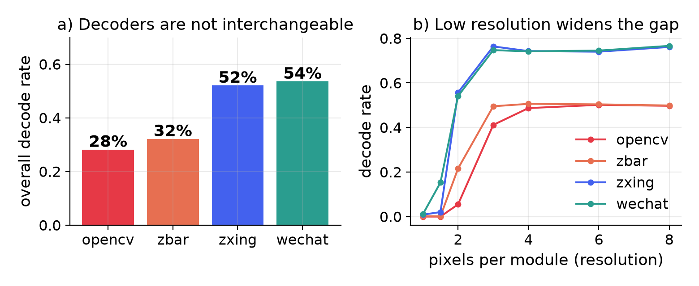
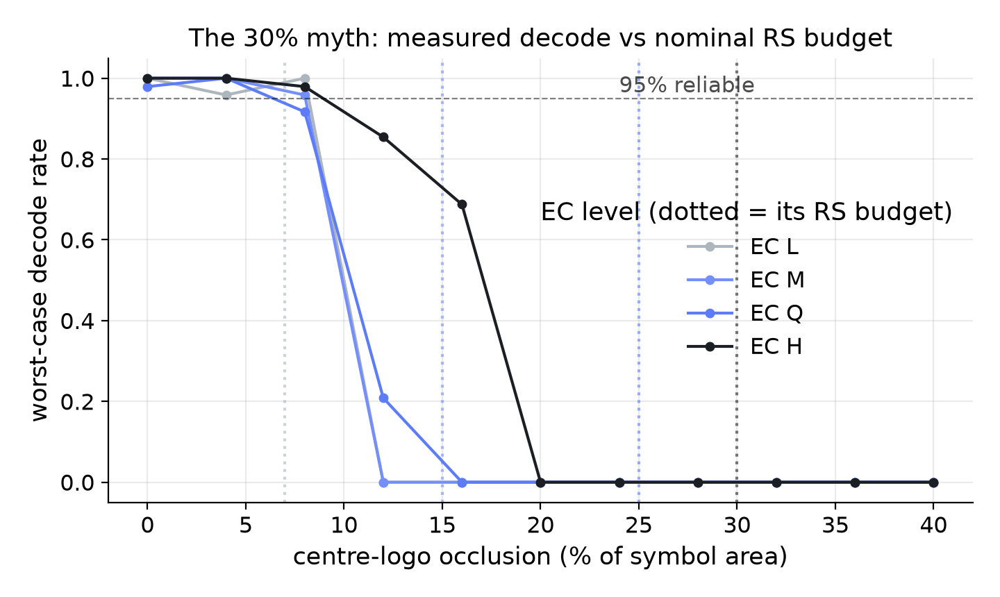
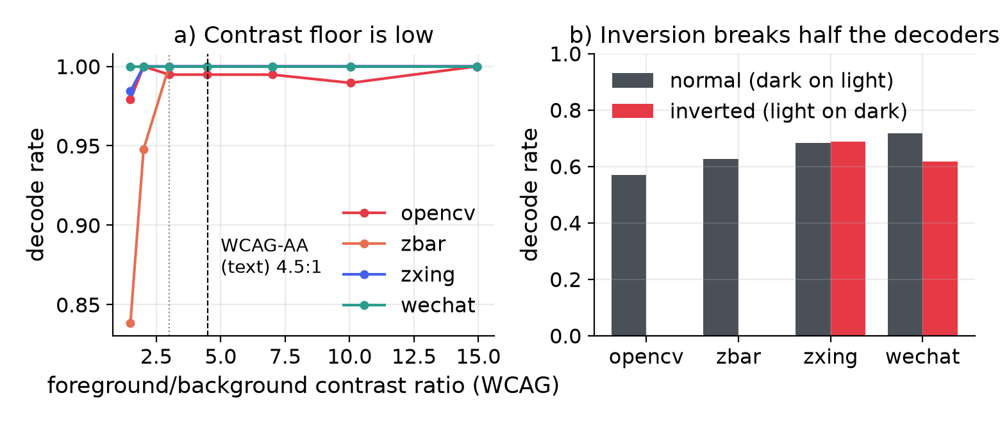
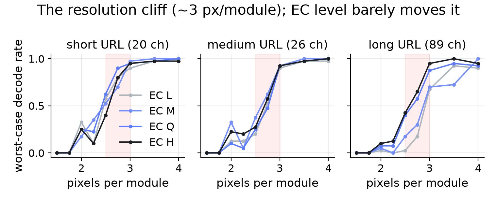
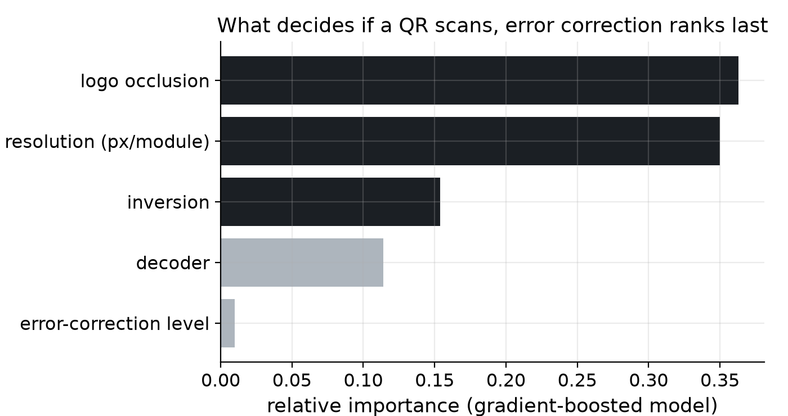

# Decoder Robustness of Stylised QR Codes under Controlled Image Degradation: A Reproducible, Decoder-Stratified Benchmark

**Sam Moreton**, OpenQR Research
Preprint v1.1 · November 2026 · Artifacts (harness, dataset, figures): CC-BY-4.0 / Apache-2.0 · Correspondence: research@openqr.uk

---

## Abstract

Designers style QR codes guided by a near-universal rule: at error-correction level H, a logo may cover ~30% of the code. The rule misreads the standard: the 7/15/25/30% figures are Reed–Solomon **codeword**-restoration rates, not areas of the symbol. We measure what stylisation actually costs, under a synthetic capture proxy, on four pinned open-source decoders (ZBar, OpenCV `QRCodeDetector`, OpenCV WeChat, `zxing-cpp`), for three payload strings (QR versions 2–4, one automatically selected mask each): 58,048 decode attempts over 907 design cells, plus a 17,280-attempt resolution sweep. A codeword-level audit shows where the two readings meet: a 16%-area centre logo corrupts 28 of the 100 codewords of a version-4-H symbol, consuming 87.5% of its 32-codeword correction budget, and all four decoders fail together at 18%, exactly where an interleaved block first overflows its per-block capacity. The measured 95%-success centre-logo ceilings are therefore per-decoder facts, not area percentages: **~16% of area (bracket 16–20%)** for ZBar, ZXing and WeChat at level H, and **~9% (bracket 8–12%)** for OpenCV's detector, which sets the conservative worst case. Reliable decoding persists to **~2:1** contrast and collapses below **~3 px/module** regardless of EC level, while inverted codes fail outright on two of the four pipelines. EC still roughly doubles occlusion headroom (M→H) and pays off for long payloads (3.9→3.0 px/module). A design-time Scannability Margin ranks decode success at leave-one-payload-out AUC 0.81–0.99 within the benchmark. Harness, dataset, audit and scorer are released for re-measurement as decoders evolve.

---

## 1. Introduction

A QR code (ISO/IEC 18004) is not a picture but a communication channel: a matrix of light/dark modules carrying a bitstream protected by Reed–Solomon (RS) error-correction codewords [4]. A decoder must *locate* the symbol via its finder and alignment patterns, *sample* each module, *binarise*, *de-interleave* and *RS-correct* up to t corrupted codewords per interleaved block, a restoration rate of nominally ~7/15/25/30% of codewords at EC levels L/M/Q/H. Every aesthetic intervention a designer makes (a centre logo, low-contrast brand colours, rounded or dotted modules, small print) injects noise into that channel. Styling a QR code is, information-theoretically, *spending decode margin*.

That spend is managed with folklore rather than measurement. The most repeated claim, embedded in generator guides and blog posts, is that EC level H "tolerates ~30% damage," licensing logos covering up to ~30% of the code. It is stated outright in current generator guidance ("keep logos within 30% of total QR code area" [15]; "you can cover nearly a third of the code and still get a perfect read" [16]), sometimes alongside the distinct width reading ("a centered logo should not exceed 30% of the total code width" [16], which for a square is 9% of area), and at least one practitioner guide already warns that the area reading is a misreading of the codeword figure [17]. This conflates three distinct quantities: (i) an RS **codeword error budget**, (ii) a **visual-area** fraction, and (iii) an **end-to-end decode probability** on a real camera and decoder. The conflation is consequential:

1. **Codewords are not area.** The 30% is a restoration rate over *codewords*; Denso Wave's own explanation defines the percentages exactly that way [2]. A codeword spans 8 modules and is spoiled by a single flipped one, and codewords straddle a logo's edge, so the fraction of codewords a contiguous logo corrupts runs *ahead* of its share of area. Correction capacity moreover binds **per interleaved RS block** (errors at unknown positions, t = ⌊r/2⌋ per block), not in total. Section 4 audits this exactly, block by block.
2. **Correction is downstream of detection.** If the front end cannot locate or sample the grid (too few pixels per module, too little contrast, an unexpected polarity), the RS budget is never reached. Real failure is often front-end-limited, the opposite of the folklore's mental model.
3. **EC is not free at fixed size.** Raising EC inflates the symbol version (more modules); at a fixed physical size each module becomes smaller and harder to sample, so more redundancy can buy *less* real-world robustness. This is a geometric prediction; the present study holds px/module fixed and therefore does not measure it (§4's scope paragraph states what is and is not tested).

Adjacent work exists and we build on it. Skurowski et al. [3] measured ZXing/ZBar/OpenCV decode performance near the sampling (Nyquist) limit and identified a ~3–3.5 pixels-per-module practical floor, with ZBar strongest and OpenCV weakest, under an MTF-based blur model; our resolution sweep replicates and extends that floor to stylised symbols under a different capture model. The aesthetic-QR line (halftone QR [5], QArt codes [6]) optimises embedding while preserving decodability; industrial print verification grades symbol contrast, modulation and defects (ISO/IEC 15415 [7]); and public decoder benchmarks (e.g. BoofCV's [8]) compare libraries on clean captures. What has not been published is a *factorial, decoder-stratified* measurement of the styling choices ordinary designers make (logo, contrast, polarity, module style, resolution), with per-decoder safety thresholds, codeword-level mechanism, and a released re-measurement harness. That is this paper's niche, claimed no more broadly.

**Contributions.** (C1) The effective centre-logo occlusion ceiling per EC level and per decoder, quantified against the *per-block* RS budget by a codeword-level audit (§4). (C2) Decoder-stratified robustness frontiers showing the weakest tested decoder governs safety. (C3) The contrast floor in WCAG units, and the inversion-polarity failure isolated as a decoder conformance difference. (C4) At matched px/module, EC level does not move the ~3 px/module resolution cliff for short/medium payloads; under occlusion it roughly doubles headroom (M→H), and it pays for long payloads. (C5) An interpretable **Scannability Margin** predictor (leave-one-payload-out AUC 0.81–0.99) and an open scoring function. All code and data are released.

---

## 2. Method

**Symbol construction.** Symbols are generated with `segno` (full control of version and EC), giving the exact module matrix. We render each module ourselves so that module *style*, *colour/contrast* and *centre-logo occlusion* are independent and reproducible. The three finder patterns are always rendered as solid squares (as production styling tools do), so the deformation penalty we measure is the data-region penalty a designer actually incurs.

**Factors.** EC ∈ {L,M,Q,H}; centre-logo occlusion ∈ {0…40}% of symbol area in 4-pt steps, in *hard* (excavated/cleared) and *overlay* (opaque) styles; contrast as WCAG ratios ∈ {1.5,2,3,4.5,7,10,15,21}:1, normal and inverted; three colour-hue pairs at matched contrast; module style ∈ {square, rounded, dots, gapped}; payloads of 20, 26 and 89 characters (fixing version growth; the 26-char payload encodes at versions 2, 2, 3 and 4 for L/M/Q/H, and segno selects the data mask per symbol, which we record); and **capture resolution** in pixels-per-module (ppm) ∈ {1…8}. One encoder caveat materially shapes the EC axis and is disclosed here and in the protocol amendments: segno's default **error-correction boosting** was left enabled, so a requested L symbol with spare capacity is silently encoded one level stronger. For the 26-char payload, requested L and M are therefore the *identical symbol* (version 2, effective M), and the EC axis has three distinct configurations: effective M at v2, Q at v3, H at v4. We report effective EC throughout and mark true-L as untested in this study. Three payload strings and one automatically chosen mask each also bound the symbol-level generality of every threshold below; the follow-up study sweeps payloads and masks.

**Capture proxy.** Native phone camera stacks cannot be automated at scale, so each clean render is passed through a degradation pipeline that emulates a real capture at a target ppm: area-resampling to ppm, mild optical Gaussian blur, sensor noise, JPEG compression, and small rotation/perspective jitter. ppm converts "module size × print size × camera distance" into a single external-validity axis. Each design cell in the main grid is captured **N=16** times with fresh random nuisance draws (seeds logged), and each cell in the supplementary resolution sweep **N=40**; the response is the decode-success rate over those captures.

**Decoders.** Every capture (an *attempt* = one capture decoded by one decoder) is independently decoded by four pinned libraries: **ZBar** via `pyzbar` (wrapper converting to grayscale first; library defaults, no symbology config), **OpenCV `QRCodeDetector`** (classical CV, `detectAndDecode` on BGR), **OpenCV WeChat** (SSD-CNN detector + super-resolution front end; its decoding core derives from ZXing), and **ZXing** via `zxing-cpp` (whose `try_invert` retry defaults to on, which is why it reads reversed-polarity images here). These are four tested *pipelines*, not four independent codebases (WeChat's decoder shares ZXing lineage), and they are representative software decoders, not a measured deployment distribution; native phone stacks (Apple Vision, Google ML Kit) are the obvious absent parties and are first-class targets of the follow-up study. A decode counts as success only on an exact payload match; wrong-payload (misdecode) outcomes were not separately tallied and are logged in the follow-up. We report per-decoder rates and the **worst-case** (min across decoders) aggregate, labelled as a conservative summary.

**Design & scale.** A fractional design (one-factor sweeps from a baseline plus three targeted interaction grids EC×occlusion×ppm, EC×contrast×ppm, EC×style×ppm) yields 907 cells and 58,048 attempts; a supplementary fine-grained ppm sweep adds 17,280 attempts to resolve the resolution cliff. The design was pre-registered (`PROTOCOL.md`) before data collection.

**Deviations from the pre-registration (disclosed in full).** The committed harness that generated the data deviates from `PROTOCOL.md` in five ways, all collection-time implementation choices baked into the released code rather than post-hoc analysis decisions. (i) Replication was increased from the planned N=12 to N=16 captures per cell. (ii) Nuisance-parameter levels differ slightly: sensor-noise σ ∈ {0, 2, 5, 8} DN (planned {0, 3, 8}), JPEG quality ∈ {50, 75, 90, 100} (planned {40, 75, 100}), rotation ±8° (planned ±10°), and optical blur σ drawn uniformly from 0.3–0.9 px rather than tied to ppm. (iii) The long payload is 89 characters, not the planned 120 (and the short payload is 20 characters, which `PROTOCOL.md` miscounts as 21 for the identical string). (iv) Two grids beyond the three pre-registered interaction grids were collected (G4: payload×EC×resolution; G5: occlusion-mode and hue checks), as was the fine-grained resolution sweep; under the protocol's own stopping rule these are labelled **exploratory**. (v) Discovered in revision: the encoder's default EC boosting was never disabled (above), and the v1.0 damage-decomposition script analysed a stand-in payload rather than the benchmark string; both are corrected in the protocol amendments, which also fix the primary estimator as interpolation with the logistic as cross-check. A note on registration practice: the v1.0 protocol, dataset and preprint share a single repository commit, so "registered before data collection" is not independently verifiable from the repo alone; the amendment list is deposited for external timestamping, and the follow-up study's protocol will be registered before collection begins. C1–C3 rest on the pre-registered grids; C4's cliff thresholds come from the supplementary sweep and its version reference from G4; C5 uses all data (exploratory grids included). Readers should weight the exploratory material accordingly.

**Analysis.** For each decoder/EC we estimate decode probability against the swept factor and report the 50%- and 95%-success thresholds (the factor value at which the decode probability crosses 0.5 and 0.95); the *safe design limit* is the 95%-success threshold of the worst-case decoder. (We avoid the label "P95", which can be misread as a percentile.) Reported thresholds are read off the empirical decode curve by **piecewise-linear interpolation** between measured factor levels (`analysis/headline.py` → `data/headline.json`); a parametric **logistic fit** (`analysis/analyze.py` → `data/summary.json`) is retained as a smoothed cross-check. The two agree closely on the level-M ceiling and the contrast floor, and to within about 1.5 percentage points on the L and Q occlusion ceilings (8.2 vs 9.5, and 6.4 vs 7.4); the one substantive divergence is the level-H occlusion ceiling, where the empirical worst-case curve is plateau-then-cliff, a shape a symmetric sigmoid cannot follow: the logistic's P95 crossing lands inside the long zero tail (~14%) rather than at the measured edge (~9%). We report the interpolated value throughout because it assumes no curve shape, and we flag the logistic figure alongside so the two committed artifacts are reconcilable. **Where the empirical curve is a step between adjacent grid levels, the bracketing levels are the honest interval and interpolated decimals are secondary; headline thresholds are stated as brackets first throughout.** Thresholds are additionally reported at 90/95/99% success (`data/model_diagnostics.json`). **Uncertainty (three layers).** We separate three sources and quantify the two we can. (i) *Capture noise* within a fixed cell: every threshold carries a bootstrap 95% CI resampling the stochastic captures within each cell, decoders paired per capture (B=1000, seeded; `analysis/ci.py` → `data/headline_ci.json`), and exact **binomial (Clopper-Pearson)** intervals (`analysis/binomial_ci.py` → `data/binomial_ci.json`) that make the sample sizes explicit: a single design cell cannot carry a 95% claim on its own (a flawless 16/16 cell has a Clopper-Pearson lower bound of only 0.79, and one miss, 15/16, drops it to 0.70). The headline occlusion thresholds rest on *pooled* binomial evidence: n=48 per occlusion level, which pools the three cells at ppm ∈ {4, 6, 8} (16 captures each) for that EC level, and n=192 per contrast level (12 pooled cells). Even a flawless 48/48 certifies only ≥92.6% (one-sided 95% bound ~93%); ~73 perfect trials would be needed to certify 95% outright, so the thresholds are estimates for the tested conditions, not certifications. (ii) *Grid spacing*: where the empirical curve steps from full decode to zero between adjacent factor levels the interval collapses to a point, and the honest uncertainty is the grid spacing itself; we report the bracketing levels and round the thresholds accordingly (~9%, ~16%, ~3 px/module). (iii) *Design-space*: the choice of nuisance grid, payload set and cell layout is itself a source of uncertainty that neither the bootstrap nor the binomial interval captures. Our intervals are conditional on the design; we do not claim they bound this third layer, and the worst-case (min-over-decoders) curve is itself a selection-biased, downward-leaning estimator, conservative in the direction of a safety limit. For C5 we fit a logistic regression and a gradient-boosted classifier on design-time features, holding out the longest payload, and additionally report leave-one-payload-out cross-validation (`data/model_diagnostics.json`).

---

## 3. Results

### 3.1 Decoders are not interchangeable (C2)

As a sanity anchor: on clean, unstyled, normal-polarity symbols at ppm ≥ 4, every library decodes essentially everything (worst-case 0.981 over 40 cells; OpenCV 98.1%, the other three 100%). Over the full stress corpus, per-library decode rates are **OpenCV 0.28, ZBar 0.32, ZXing 0.52, WeChat 0.54** (Fig. 1a; bootstrap 95% CIs within ±0.01). These are *design-weighted rates over a deliberately stressful grid* (1 ppm cells, 40% occlusion, 1.5:1 contrast, inversion), so their absolute values are not field failure rates; they support comparison between libraries on identical captures, which is their use here. The libraries split into a weak tier (OpenCV `QRCodeDetector`, ZBar) and a strong tier (`zxing-cpp`, WeChat) whose members succeed nearly twice as often on the same styled symbols. Because WeChat's decoder core derives from ZXing while its detector differs, the split is between implementations and configurations, not between algorithm classes. The gap widens sharply at low resolution (Fig. 1b): at ppm ≤ 2, decode rates are OpenCV **0.02**, ZBar **0.08**, ZXing **0.21**, WeChat **0.25**, a 4–13× spread in success rate (stated carefully: at this resolution *every* library fails most of the time, with failure rates of 75–98%, so the spread is in how often a scan succeeds, not a claim that one library fails 13× more often). The practical consequence is that a code verified on one reader (whose pipeline behaves like the strong tier) can systematically fail on ZBar/OpenCV-class readers. We make no claim about which readers ship inside specific kiosks or point-of-sale fleets; the benchmark measures the four tested pipelines, and the released harness re-measures any others. **The weakest decoder your audience uses, not the author's phone, is the real specification.**

### 3.2 The occlusion ceiling: codewords are not area (C1)

At good resolution (ppm ≥ 4), worst-case decode rate collapses far to the left of the folklore's 30% (Fig. 2). The 95%-success centre-square occlusion ceilings, stated as **brackets over the grid levels** (interpolated value in parentheses), are: **effective-M (v2): between 8 and 12% (8.2); Q (v3): between 4 and 8% (6.4); H (v4): between 8 and 12% (8.9) worst-case, and between 16 and 20% (16.2) excluding OpenCV**. Requested L and M are the same effective-M symbol (§2), so their 8.2/8.0 agreement is identity, not replication. The Q-below-M ordering (6.4 vs 8.0) is a single-symbol-per-level artefact within grid spacing, not an EC effect we interpret. Even at level H, then, you can safely clear only ~9% of the area if the code must read on every tested library, versus the folklore 30%.

Centre-square *area* is not module damage, and module damage is not codeword damage (`analysis/damage.py`, regenerated for the exact benchmark symbols; the codeword mapping is new in `analysis/codeword_audit.py`). A white logo pad erases only the *dark* modules beneath it, all in the data region until ~24% area (v4). For the level-H symbol (version 4, 33×33, mask 3): a 16%-area logo covers 15.5% of modules, *changes* 7.7% of them (the dark fraction under the pad, ~0.50), and corrupts **28 of the 100 codewords**, each spoiled by a single flipped module. A 9%-area logo changes 3.8% of modules and corrupts 13 codewords. Area therefore *understates* codeword damage by roughly 2–3.5× at these versions, the opposite of the intuition that a white pad is gentle.

Decomposing by library, and leading with it: at Q and H the pooled worst case is set by **one implementation, OpenCV's `QRCodeDetector`**. The interpolated H ceilings are OpenCV **8.9%** (bracket 8–12%) and ZBar, ZXing, WeChat **all 16.2%** (bracket 16–20%; a hard step: every capture decodes at 16% occlusion and none at 20%) (`occ_p95_by_decoder` in `data/headline.json`). At effective M all four libraries share the ~8% ceiling. The design guidance is two-sided: budget **~9%** of area if OpenCV-class readers must succeed, **~16%** if not; in both cases far below 30%.

A pristine-image control (`analysis/oracle.py`, §4) bounds what capture degradation costs: even an undegraded render of the occluded symbol fails on all four libraries together just above 16% at H, so the ~9% seen under the capture proxy is front-end/capture limited, and ~16% is the symbol-channel limit. Section 4's codeword audit shows that limit *is* the per-block Reed–Solomon budget: at 16% occlusion the H symbol's four interleaved blocks sit at [7, 7, 7, 7] corrupted codewords against a capacity of t=8 per block, and at 18% one block overflows ([8, 8, 10, 8]) exactly where every library fails. EC therefore clearly buys occlusion headroom for three of the four decoders (8% → 16% from effective M to H; the pristine ceiling doubles the same way); what it does not buy is resolution (§3.4). The 30% figure overstates safe logo area by roughly **1.9× (any tested library except OpenCV) to 3.4× (worst case including OpenCV)**.

### 3.2.1 Logo mode, hue and module style (collected in v1.0, reported here)

Three factors were collected in v1.0 but went unreported; numbers from the committed data (`analysis/factor_report.py` → `data/factor_report.json`), worst-case unless stated. **Logo mode.** An opaque black block painted over the symbol (naive overlay) decodes materially worse than an excavated white pad at the same nominal area (matched EC ∈ {M, H}, occlusion 8–32%, ppm ∈ {2, 4, 6}): worst-case 0.159 vs 0.216, every decoder losing 5–12 points. The codeword audit supplies the mechanism: an overlay flips the *light* modules, and on these small versions that corrupts a codeword set with less per-block slack (audit ceiling 4% vs 10% at effective M). Excavate the pad; do not paint over modules. **Hue at matched WCAG contrast.** Navy/cream, red/white and green/white pairs at nominally matched ratios decode at worst-case 0.71 / 0.69 / 0.65 (EC Q, ppm 2–6). The ordering is consistent with decoders binarising gamma-encoded luma rather than WCAG linear luminance: green compresses worst in grey conversion, so its realised grey contrast is lower than its WCAG ratio implies. **Module style.** At adequate resolution (ppm ≥ 4), rounded and dots styles decode at worst-case 1.000, gapped at 0.938 (ZXing the binding decoder), against 0.981 for plain squares: styling is essentially free once resolution is adequate. Pooled over all ppm the styles inherit the cliff (dots 0.600, rounded 0.585, gapped 0.556 worst-case). The v1.0 advice-table claim that styles are "comparatively safe" is grounded, from here on, in these numbers.

### 3.3 The contrast floor is low; inversion is a conformance difference (C3)

Under our synthetic capture proxy, decoding is remarkably contrast-tolerant: the worst-case 95%-success contrast floor is **~2:1** (bootstrap 95% CI 1.9–2.4), and the strong-tier decoders read reliably down to **1.5:1** (Fig. 3a), beneath the WCAG-AA text-contrast threshold of 4.5:1. Contrast, contrary to common advice, is rarely the binding constraint when resolution is adequate. This is a synthetic-image result in WCAG luminance units, not a print recommendation: physical print/scan robustness is better described by barcode-grading quantities (symbol contrast, modulation, reflectance, print growth), which ISO/IEC 15415 [7] grades under real illumination and we do not; and decoders binarise gamma-encoded luma, not WCAG luminance (§3.2.1's hue result shows the difference is visible). Read it as "contrast was not the binding constraint above ~2:1 given adequate resolution", pending print-grade validation.

Polarity, however, is. When the code is **inverted** (light modules on a dark field, an extremely popular aesthetic), **OpenCV and ZBar decode it 0% of the time**, while ZXing is unaffected (68.3% → 68.7%) and WeChat degrades only modestly overall (71.7% → 61.8%), its penalty concentrated at low resolution (Fig. 3b). This is not a new discovery about the symbols; it is a long-documented decoder *conformance difference*. ISO/IEC 18004 treats reflectance reversal as an optional decoder feature [1], `zxing-cpp` retries inverted images by default (`try_invert=True`, hence its 68.7% here), and the behaviour is on the trackers: zbar gained inverted-code support only through a community patch merged in 2019 [18], which the default deployment path we pin still lacks (0% on inverted here), and OpenCV carries an open report that `QRCodeDetector` does not detect white-on-black codes [19]. Our contribution is the isolation of *what exactly* breaks: the common aesthetic inverse inverts the symbol field together with its quiet zone, mixing module polarity with quiet-zone polarity. A four-condition rerun (`analysis/inversion_conditions.py`) separates them, labelling conditions by their actual colours rather than compliance judgments: the fully inverted symbol (dark field, dark quiet zone) is the internally consistent inverted presentation, and it is what ZBar and OpenCV still refuse (0% across every EC level and resolution), so their failure is genuine module-polarity, not a quiet-zone artifact. The variant with a light quiet zone around the dark field is the polarity-inconsistent one, and it is what breaks ZXing's global-inversion retry; WeChat's CNN reads all four conditions. That a one-line preprocessing step (invert the image before decode) restores decoding on every library confirms the failure is a detector-side polarity assumption, not lost symbol information. We measured libraries, not deployment share; our single real-device check (a Pixel 7's native camera, §4) read inverted codes. Read this as a decoder-coverage hazard: an inverted code narrows your readership to inversion-aware scanners. Designers should avoid inversion for high-stakes print, or test on strict-polarity readers.

### 3.4 What error correction buys, and what it does not (C4)

Decode success under our capture proxy is governed by a **resolution cliff at ~3 pixels per module** (Fig. 4): at or below ~1.75 ppm worst-case decoding is zero, it stays unreliable through ~2.5 ppm (worst-case 12–35%), and above ~3.5 ppm it saturates (≥95%). The minimum resolution for 95% worst-case decoding is **~3.0–3.3 px/module and is essentially independent of EC level** for the short and medium payloads (26-char: effective-M 3.17, Q 3.25, H 3.25; 20-char: 2.98–3.33; bootstrap 95% CIs span 2.97–3.75 across levels). Requested L and M are the same effective-M symbol, so the 20-char pair's 3.33 vs 2.98 is a *pure capture-noise replication estimate* (~0.35 px/module) on identical symbols, which calibrates how much of the inter-EC spread is noise. Because the sweep varies px/module directly, module size is held constant by construction; the supported mechanism is the front-end one: **once sampling fails, the parity is never consulted**. Version inflation cannot explain a cliff plotted against px/module; it matters only at *fixed physical size*, where raising EC shrinks each module, a geometric prediction this study does not measure and §4 lists as untested. Where EC does pay is larger payloads: for the 89-character URL the 95% cliff *falls* with EC (M 3.91 → Q 3.50 → H 3.00 px/module; at true L the worst-case curve never reaches 95% within the swept range). Encoding *mode* acts through the same channel (`analysis/payload_modes.py`; the 25-character budget comparison is at EC H): numeric encodes as version 2, alphanumeric 3, byte/URL 4, i.e. a 33/25 ≈ 1.3× denser grid for the URL case at identical content length, yet the cliff sits at the same ~3 px/module for all three modes. Mode therefore changes scannability only through version and module size, not through a mode-specific cliff, which is why the URL-only (byte-mode) benchmark is the conservative case and why physical module size, not character count, is the governing variable. In full: *for the tested short and medium payloads under our synthetic capture degradation, resolution dominates EC and raising EC does not shift the px/module cliff; EC's measured benefits are occlusion headroom (§3.2: 8% → 16% from effective M to H) and long-payload cliff reduction, and its expected benefit under localised print damage, dirt or scratches is untested here.*

### 3.5 What actually predicts scannability (C5)

A model trained on design-time features **ranks** per-capture decode success at held-out AUC **0.912 (logistic) / 0.982 (gradient-boosted)** on the long payload, exceeding the pre-registered 0.85 bar. That single number flatters the model, and we now say how. First, **leave-one-payload-out CV** gives three generalisation numbers rather than one: GBM AUC **0.992 (short held out), 0.812 (medium), 0.982 (long)** (`data/model_diagnostics.json`). The medium fold is the honest one: the medium payload carries the occlusion/contrast/inversion variation, and a model trained without it drops to 0.81. Second, the long-payload holdout **varies only resolution, EC and version** (occlusion 0, no inversion, contrast fixed), so its AUC and its feature importances exercise the easy cliffs: permutation importance there is px/module 0.46 and ~0 for every other feature, while in the training *boundary band* (ppm 2–4 or occlusion 4–20%, where a designer actually chooses) it is occlusion 0.34, px/module 0.11, inversion 0.07, EC 0.02. Boundary-band discrimination is GBM AUC 0.968 / 0.728 / 0.944 across the three folds. Impurity importances (Fig. 5) are kept as the interpretable ranking but permutation importance is the unbiased one. Two further honesty notes: EC ranking last in a main-effects model does not mean EC is irrelevant, it acts through interaction with occlusion (§3.2: the ceiling doubles M→H); and **resolution is not truly a design-time feature** (it depends on print size, camera and scan distance), so the scorer treats px/module as a *scenario* input, not a property of the artwork.

The shipped scorer (`analysis/export_scorer.py`) is a *separate* logistic per decoder on design-time features only (per-decoder held-out AUC 0.94–0.97), combined into a **worst-case** margin and two capability-based profiles: **strong tier** (`zxing-cpp`/WeChat, inversion-aware) and **strict-polarity tier** (ZBar/OpenCV). The safe/risky/fragile **grade** cutoffs are fitted on *training cells only* (v1.0 fitted them on all cells including training, a circularity fixed in the amendments): risky ≥ 0.577, safe ≥ 0.992. On training cells the bands decode at worst-case **0.04 / 0.91 / 0.98** (fragile/risky/safe); on the held-out long-payload cells **0.00 / 0.30 / 0.96**. The held-out risky band's 0.30 says plainly that the *grade* does not transfer cleanly to an unseen payload family, so the grade is validated within the benchmark's payload families and nothing more is claimed for it. (The §2 "safe design limit" is the 95%-success threshold; the scorer's "safe" band certifies 98% worst-case on training cells: two different "safe"s, stated explicitly here.) For a calibrated *probability* the gradient-boosted model is used (next paragraph). C5 uses all grids including the exploratory ones; weight accordingly.

**Calibration: does the predicted probability mean anything?** AUC ranks; it does not show that a predicted P(decode) is trustworthy, so we check calibration on the held-out long payload (Fig. 6; `analysis/calibration.py`, n=1792). Two caveats frame everything below: the held-out outcomes are dominated by easy cliffs (near-0 and near-1 probabilities), where calibration is easy, so ECE is necessary rather than sufficient; and the held-out payload varies only resolution and EC (§3.5). The concern is real for the **logistic** model: it ranks well (AUC 0.91) but is badly miscalibrated (Brier 0.24, ECE 0.27), systematically overconfident, so it ships only for its interpretable coefficients, never as a probability. The **gradient-boosted** model is both accurate and reasonably calibrated (AUC 0.98, Brier 0.04, ECE 0.02; worst-case per-decoder ECE 0.05 on OpenCV), its reliability curve tracking the diagonal on average though noisy at mid-probability; post-hoc isotonic recalibration overfits this single held-out payload and makes it worse (ECE 0.07), so we keep the raw model. This is calibrated enough to expose an approximate P(decode); the **grade** is a separate object whose cutoffs are training-cell-calibrated and whose transfer to unseen payload families is explicitly weak (§3.5). Tighter probability claims, and calibration on unseen versions, styles and devices, remain future work.

### 3.6 A practitioner's frontier (replacement rules of thumb)

Every row is conditional on the benchmark's scope: centre-square blank-pad logos, versions 2–4, three payload strings, one automatic mask each, the synthetic capture proxy, four pinned decoders. Evidence basis is stated per row.

| Design choice | Common advice | Measured reality (worst-case decoder) | Evidence |
|---|---|---|---|
| Logo area | "up to 30% at EC H" | **~9%** of area (bracket 8–12%) if OpenCV-class readers must succeed; **~16%** (bracket 16–20%) for the other three tested libraries. 30% is a codeword rate, not an area share | pre-registered grid + codeword audit |
| Logo mode | (unstated) | **excavate** the pad: a black overlay costs every decoder 5–12 points at equal area | exploratory G5 + audit |
| Minimum resolution | rarely stated | **≥ ~3.3 px/module** at 95% (3.0 at 90%, 3.9 at 99%); EC does not lower it for short/medium payloads, H lowers it for long payloads (3.9 → 3.0) | pre-registered + sweep |
| Error-correction level | "always use H" | does not move the resolution cliff; **doubles occlusion headroom** (M→H); expected to pay under localised damage (untested). At fixed print size it shrinks modules (untested prediction) | pre-registered + audit |
| Contrast | "keep it high" | reliable to **~2:1**, below WCAG-AA; not the binding constraint at adequate resolution | pre-registered |
| Inverted (light-on-dark) | "fine" | **fails on 2 of 4 tested pipelines** (ZBar, OpenCV); an optional-feature conformance difference, not data loss | pre-registered + 4-condition rerun |
| Module style (rounded/dots) | "risky" | at ppm ≥ 4: rounded and dots **1.000**, gapped 0.94 worst-case; free once resolution is adequate | exploratory G3 |
| Which decoder you test on | (unstated) | **test the weakest reader your audience uses**, not your phone | all of the above |

---

## 4. Discussion, limitations, threats to validity

**Library decoders are a conservative proxy, with stated limits.** Modern phone scanners behave like the strong tier (`zxing-cpp`/WeChat); our worst-case aggregate (set at Q/H by OpenCV's `QRCodeDetector`) is therefore a *lower bound* for a strong-tier-only audience. Whether ZBar/OpenCV-class readers matter to a given deployment is a fact about that deployment that we do not measure; the harness exists so that any additional reader (Apple Vision, ML Kit, a physical kiosk scanner) can be added and the ceilings re-stated.

**A single-device pilot, consistent with the proxy.** We scanned a 28-cell sample (22 on-screen cells spanning the studied factors, plus a 6-step printed-size sweep) on a Google Pixel 7 with its native camera; the phone's per-cell outcome matched the strong-tier (`zxing-cpp`/WeChat) prediction on all 28 (`validation/results-pilot-pixel7.json`). For occlusion, the phone read up to 18% centre-logo area and failed at 24%, 30% and 36%, consistent with the strong-tier ceiling of 16–20%. A single capture succeeding at 18% says nothing about a 95% rate, and a 28-cell agreement is a consistency check, not validation; by the paper's own §2 standard, dozens of captures per cell across several devices would be needed. The inverted code scanned (as expected for an inversion-aware decoder); contrast read down to 1.5:1; all module styles read; the 2 px/module on-screen code scanned only within a narrow distance window. The printed sweep read reliably at a **0.30 mm** module and was marginal at 0.25 mm and 0.20 mm. That floor is a property of this phone's near-focus limit and this printer, not a conversion of the px/module cliff; it lands inside the range long published in industrial guidance (GS1 specifies application-specific X-dimension minima around 0.25 mm with larger preferred targets [14]), which corroborates the ballpark without adding a measurement. This is a single-device point; the validation harness (`validation/`, protocol v1: measured 25 cm distance, lux-recorded sessions, timed scan windows) is released so the sample can be re-run across devices.

**Front-end capacity vs symbol-channel capacity, measured both ways.** Two analyses separate the stages. A *pristine-image control* (`analysis/oracle.py`) decodes the same occluded symbols from a large, undegraded render, bypassing the capture pipeline but still passing through each library's own detector. A *codeword audit* (`analysis/codeword_audit.py`) closes the loop the control cannot: it walks the exact benchmark symbols' module matrices through the ISO/IEC 18004 placement zigzag and block de-interleaving (validated by round-tripping the undamaged symbol's data codewords to the exact payload string), maps each occlusion level to corrupted codewords **per interleaved RS block**, and compares against each block's correction capacity t. A block is decodable iff its corrupted count ≤ t, so the audit predicts the RS limit directly from the matrices, with no decoder in the loop.

At level H (version 4: four blocks of 9 data + 16 parity codewords, t = 8 per block, budget 32 of 100 codewords):

| centre logo | modules changed | codewords corrupted | per-block corrupted (t=8) | audit verdict |
|---|---|---|---|---|
| 8–9% of area | 3.8% | 13 of 100 | [4, 5, 1, 3] | well within budget |
| 16% of area | 7.7% | 28 of 100 | [7, 7, 7, 7] | 87.5% of budget; decodable |
| 18% of area | 10.6% | 34 of 100 | [8, 8, 10, 8] | one block overflows |

All four libraries decode the pristine render at 16% and fail at 18%: **the pristine ceiling is the RS block budget**, and interleaving spreads the pad's damage almost perfectly evenly ([7, 7, 7, 7]). The other levels agree within a grid step: effective-M (v2, one block, t=8) overflows at 12% occlusion (13 corrupted), where the pristine decoders fail at 10–12%; Q (v3, two blocks, t=9) overflows at 12% ([9, 10]), where ZXing fails exactly and the others one step later. Sub-step residuals (ZBar failing one step early at effective M; three decoders surviving Q at 12%) sit within pad-edge pixel rounding and decoder sampling margins.

Three consequences. First, the folklore's "30% damage" is *consumed* by a 16%-area pad on this symbol: 28 corrupted codewords against a 32-codeword budget. The nominal rate is delivered as advertised; it is codeword granularity (one flipped module spoils an 8-module codeword), the function-pattern share of the symbol, and edge straddling that map 30% of codewords to only 16–20% of area on versions 2–4, with the ceiling version- and geometry-dependent. Second, the degraded-pipeline ceiling (~9% at H) sits far below the pristine ceiling, and the 9-to-16% band decodes cleanly with no capture degradation: failure across it is **front-end/capture limited** (detection and sampling), not codeword loss. Third, at effective M the pristine and degraded ceilings nearly coincide (~8%), so there the ceiling is already symbol-channel limited, and front-end headroom grows with EC.

**Scope.** We model the dominant *centre-square blank-pad* logo; corner and scattered logos, structured or coloured logos, and true artistic/diffusion codes are out of scope. The three finder patterns are always solid squares, so finder/eye styling is untested. Quiet-zone width is fixed at the compliant default and never varied. Versions 2–4 only: from version 7 a centre logo meets alignment patterns, untested here. Print physics (ink bleed, substrate, specular reflection) are approximated by the ppm/blur/noise/JPEG proxy; blur σ is 0.3–0.9 px of the post-resample image rather than ppm-tied as pre-registered, so absolute cliff positions are properties of this pipeline (the harness re-runs any variant). The fixed-print-size EC trade-off (§1, item 3) is a prediction, not a measurement. Decoder behaviour is version-specific by construction; results should be re-run as decoders evolve, which is why the harness is released.

---

## 5. Conclusion

QR-code design advice is built on a category error: a codeword *error-correction rate* treated as a visual-area allowance on an idealised decoder. Measured against four pinned software decoders under our synthetic capture proxy, for a centre-square blank-pad logo on versions 2–4 with three payload strings: the safe logo area is 1.9–3.4× smaller than the folklore 30%, depending on whether OpenCV-class readers must be supported; a codeword audit shows the pristine ceiling is exactly the per-block Reed–Solomon budget (a 16%-area pad corrupts 28 of the H symbol's 100 codewords, and the first block overflow at 18% is where every tested decoder fails); error correction does not move the ~3 px/module resolution cliff for short and medium payloads, but doubles occlusion headroom and lowers the cliff for long payloads; resolution is the true currency; and light-on-dark codes fail on two of the four tested pipelines, a decoder conformance difference, not lost symbol information. These conclusions are decoder-aware, resolution-aware, and conditional on the tested scope: symbol generalisation (many payloads, all masks, versions ≥5), real deployment decoders (Apple Vision, ML Kit), localised physical damage, and print-grade validation are the registered territory of the follow-up study. We release the benchmark, the dataset, the codeword audit and an open design-time Scannability Margin so the field can replace folklore with measurement, and re-measure as decoders change.

---

## Artifacts & reproducibility
- Harness (Apache-2.0), dataset (`results.parquet`, `results_cliff.parquet`, CC-BY-4.0), figures, fixed seeds and analysis scripts are released in the repository (github.com/open-qr/scannability-benchmark) and archived on Zenodo at DOI **10.5281/zenodo.24327737** (reserved; resolves on publication); everything cited regenerates from the committed data.
- Every attempt is reproducible from a clean checkout via fixed seeds. Pinned versions: segno 1.6.6 (encoder), OpenCV + contrib 4.13.0.92 (`QRCodeDetector` and the WeChat SSD-detector + super-resolution model files from opencv_contrib), pyzbar 0.1.9 (ZBar wrapper), zxing-cpp 3.0.0, scikit-learn 1.9.0, numpy 2.5.0, pandas 3.0.3; the full lockfile is `harness/requirements.txt`. pyzbar wraps the host's `libzbar`, so the release record additionally pins the container digest and libzbar build used for the reported numbers and lists SHA-256 hashes of the WeChat model files. Decoder settings are library defaults except as stated in §2 (zxing-cpp `try_invert` defaults on; zbar defaults; grayscale conversion only in the ZBar path). The capture pipeline's transform order is fixed in `harness/degrade.py`: area-resample to target ppm → rotation/perspective warp → Gaussian blur → sensor noise → JPEG.
- All reported numbers regenerate from the committed data: `analysis/headline.py` writes `data/headline.json` (interpolated headline figures incl. per-decoder ceilings), `analysis/analyze.py` writes `data/summary.json` (logistic cross-check and C1–C5 tables), `analysis/ci.py` writes `data/headline_ci.json` (bootstrap CIs), `analysis/binomial_ci.py` writes `data/binomial_ci.json` (Clopper-Pearson), `analysis/damage.py` writes `data/damage.json` (area vs module decomposition), `analysis/codeword_audit.py` writes `data/codeword_audit.json` (per-block RS audit, new in v1.1), `analysis/oracle.py` writes `data/oracle.json` (pristine-image control), `analysis/inversion_conditions.py` writes `data/inversion_conditions.json` (four polarity conditions), `analysis/calibration.py` writes `data/calibration.json` (reliability, Brier, ECE), `analysis/payload_modes.py` writes `data/payload_modes.json` (mode/version), `analysis/model_diagnostics.py` writes `data/model_diagnostics.json` (LOPO CV, permutation importance, 90/95/99 thresholds, new in v1.1), `analysis/factor_report.py` writes `data/factor_report.json` (style/hue/logo-mode results, new in v1.1). `analysis/export_scorer.py` emits the Scannability Margin scorer.
- Protocol: `PROTOCOL.md` (frozen v1.0 design) plus the v1.1 amendment list; deposited for external timestamping at release.
- `validation/` is a self-recording real-device harness: it renders the same styled codes, serves them over the local network, and logs each phone scan (pass / marginal / no-scan) against the study's strong-tier prediction, with a print-at-known-size sheet and a camera-distance check for the resolution cliff. It is the instrument for the single-device pilot reported in Section 4.

## Competing interests and funding
The author develops OpenQR, a commercial QR-code generator that ships a Scannability Margin scorer derived from this benchmark; the benchmark, dataset and scorer source are released under the licences above so the results can be checked independently. No external funding.

## References
1. ISO/IEC 18004:2024. *Information technology, Automatic identification and data capture techniques, QR Code bar code symbology specification.* International Organization for Standardization. https://www.iso.org/standard/83389.html
2. DENSO WAVE INCORPORATED. *Error correction feature* (defines the 7/15/25/30% figures as data-restoration rates over total codewords). https://www.qrcode.com/en/about/error_correction.html (accessed 2026-11-17)
3. P. Skurowski, K. Nurzyńska, M. Pawlyta, K. A. Cyran (2022). Performance of QR Code Detectors near Nyquist Limits. *Sensors* 22(19):7230. https://doi.org/10.3390/s22197230
4. I. S. Reed and G. Solomon (1960). Polynomial codes over certain finite fields. *Journal of the Society for Industrial and Applied Mathematics* 8(2):300–304. https://doi.org/10.1137/0108018
5. H.-K. Chu, C.-S. Chang, R.-R. Lee, and N. J. Mitra (2013). Halftone QR Codes. *ACM Transactions on Graphics (SIGGRAPH Asia)* 32(6):217. https://doi.org/10.1145/2508363.2508408
6. R. Cox (2012). *QArt Codes.* Technical note. https://research.swtch.com/qart
7. ISO/IEC 15415:2024. *Information technology, Automatic identification and data capture techniques, Bar code print quality test specification, two-dimensional symbols.* International Organization for Standardization.
8. P. Abeles. *Study of QR Code Scanning Performance in Different Environments.* BoofCV performance benchmark. https://boofcv.org/index.php?title=Performance:QrCode (accessed 2026-11-17)
9. ZXing contributors. *ZXing ("Zebra Crossing") barcode library*; `zxing-cpp` C++ port. https://github.com/zxing-cpp/zxing-cpp (accessed 2026-07-02).
10. J. Brown et al. *ZBar bar-code reader.* https://github.com/mchehab/zbar (accessed 2026-07-02); Python bindings `pyzbar` https://github.com/NaturalHistoryMuseum/pyzbar.
11. OpenCV contributors. *WeChat QRCode module* (SSD detector + super-resolution; decoding core derived from ZXing), OpenCV contrib. https://github.com/opencv/opencv_contrib/tree/master/modules/wechat_qrcode (accessed 2026-07-02).
12. F. Pedregosa, G. Varoquaux, A. Gramfort, et al. (2011). Scikit-learn: Machine Learning in Python. *Journal of Machine Learning Research* 12:2825–2830. https://jmlr.org/papers/v12/pedregosa11a.html (used here for `LogisticRegression` and `GradientBoostingClassifier`).
13. W3C (2023). *Web Content Accessibility Guidelines (WCAG) 2.2*, Success Criterion 1.4.3 Contrast (Minimum). https://www.w3.org/TR/WCAG22/#contrast-minimum
14. GS1. *GS1 General Specifications* (application-specific X-dimension minima and targets). https://www.gs1.org/standards/barcodes (accessed 2026-11-17)
15. MyQR Barcode Generator (2026). *QR Code Design Tips: Customize Without Compromising Scannability* ("Keep logos within 30% of total QR code area. Larger than this risks breaking scannability."). https://myqrbarcodegenerator.com/en/blog/qr-code-design-tips (accessed 2026-11-17; archived at http://web.archive.org/web/20261117204101/https://myqrbarcodegenerator.com/en/blog/qr-code-design-tips)
16. QR-Verse (2026). *QR Code Error Correction: Why Logos Still Scan* ("you can cover nearly a third of the code and still get a perfect read"; also "a centered logo should not exceed 30% of the total code width"). https://qr-verse.com/en/blog/qr-code-error-correction-explained (accessed 2026-11-17; archived at http://web.archive.org/web/20261117204120/https://qr-verse.com/en/blog/qr-code-error-correction-explained)
17. Tabres (2026). *How to Add Your Logo to a QR Code Without Breaking It* ("'Level H repairs 30% damage' gets read as 'so my logo can cover 30% of the code.' It can't."). https://tabres.com/articles/how-to-add-logo-to-qr-code-without-breaking-it (accessed 2026-11-17; archived at http://web.archive.org/web/20261117204139/https://tabres.com/articles/how-to-add-logo-to-qr-code-without-breaking-it)
18. mchehab/zbar pull request #18, *Add support for inverted codes* (opened February 2019, merged). https://github.com/mchehab/zbar/pull/18 (accessed 2026-11-17)
19. opencv/opencv issue #30588, *QRCodeDetector does not detect inverted (white-on-black) QR codes* (opened October 2026, open at access). https://github.com/opencv/opencv/issues/30588 (accessed 2026-11-17)
